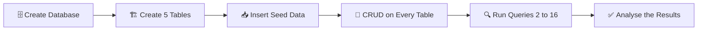
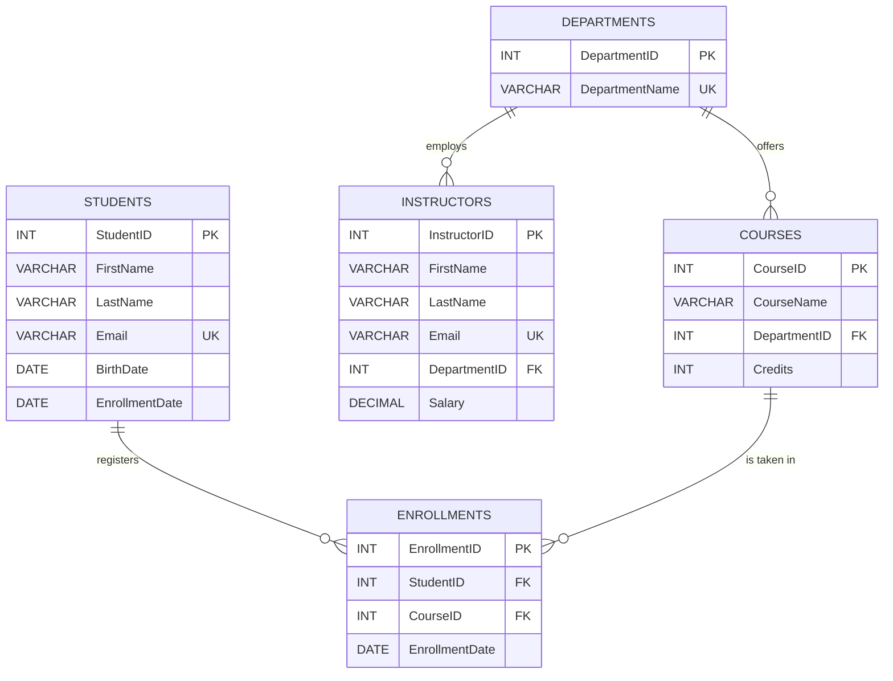
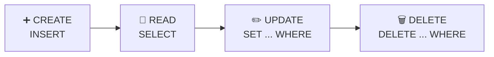

<div align="center">


# 🎓 University Course Management System 🎓

### ✨ SQL Final Project &nbsp;|&nbsp; Created by **Nihar Sheladiya** ✨

<br/>


<br/>

### 🎓 *A complete, relational database system that manages students, courses, instructors, departments and enrollments — built from scratch with pure SQL.* 🎓

<br/>


</div>

<br/>

## 📚 Table of Contents

| # | Section | # | Section |
|:-:|---------|:-:|---------|
| 1️⃣ | [🌟 About the Project](#-about-the-project) | 9️⃣ | [🔍 SQL Queries Showcase](#-sql-queries-showcase) |
| 2️⃣ | [✨ Key Features](#-key-features) | 🔟 | [📊 Query Summary](#-query-summary) |
| 3️⃣ | [🧰 Tech Stack](#-tech-stack) | 1️⃣1️⃣ | [🧠 SQL Concepts Covered](#-sql-concepts-covered) |
| 4️⃣ | [📁 Repository Structure](#-repository-structure) | 1️⃣2️⃣ | [🎓 Key Learnings](#-key-learnings) |
| 5️⃣ | [🧩 Database Design](#-database-design) | 1️⃣3️⃣ | [🐞 Troubleshooting](#-troubleshooting) |
| 6️⃣ | [💾 Sample Data](#-sample-data) | 1️⃣4️⃣ | [🔮 Future Enhancements](#-future-enhancements) |
| 7️⃣ | [🚀 Getting Started](#-getting-started) | 1️⃣5️⃣ | [🎬 Video Demo](#-video-demo) |
| 8️⃣ | [🔁 CRUD Operations](#-crud-operations) | 1️⃣6️⃣ | [🙋 About the Author](#-about-the-author) |

<br/>

<div align="center"></div>

## 🌟 About the Project

Welcome to the **University Course Management System** — my **SQL Final Project**! 🎉

This project brings together a broad range of SQL concepts in one practical, real-world scenario. Instead of practising isolated commands, I designed a **complete relational database for a university** and then used it to answer **16 realistic tasks** — from basic CRUD operations all the way to joins, subqueries, date and string functions, **window functions** and the **`CASE` expression**.

> 💡 **Think of it as a mini university back-office:** who the students are, which courses exist, who teaches in which department, and which student is enrolled in which course.

### 🎯 Project Objectives

- 🏗️ Design a **normalized, constraint-driven** database with five related tables
- 🔗 Connect the tables with **primary keys, foreign keys, unique constraints and cascading deletes**
- 🔁 Perform **full CRUD** (Create, Read, Update, Delete) on **every** table
- 🔍 Write **filtering, sorting, grouping and aggregation** queries
- 🤝 Combine data using **INNER JOIN** and **LEFT JOIN**
- 🪆 Use **subqueries** to solve multi-step problems
- 📅 Apply **date**, **string** and **window** functions
- 🏷️ Use **`CASE`** to build conditional labels

<br/>

## ✨ Key Features

| | Feature | Description |
|:-:|---------|-------------|
| 🏛️ | **5 Related Tables** | Departments, Students, Courses, Instructors and Enrollments |
| 🔐 | **Data Integrity** | `PRIMARY KEY`, `FOREIGN KEY`, `NOT NULL` and `UNIQUE` constraints everywhere they matter |
| 🌊 | **Cascading Deletes** | Removing a student or course automatically cleans up its enrollments |
| 🚫 | **No Duplicate Enrollments** | A composite `UNIQUE (StudentID, CourseID)` stops a student enrolling twice in one course |
| 🌱 | **Seed Data** | 38 pre-loaded rows (3 departments, 12 students, 5 courses, 3 instructors, 15 enrollments) |
| 🔁 | **Full CRUD** | Insert, read, update and delete demonstrated on all five tables |
| 🔍 | **15 Analytical Queries** | Filters, aggregates, joins, subqueries, date/string/window functions and `CASE` |
| 📖 | **Well Commented Script** | Every section of the `.sql` file is labelled and easy to follow |

<br/>

## 🧰 Tech Stack

<div align="center">

| 🧱 Technology | 🎯 Purpose |
|:-------------:|:----------|
|  | Relational database engine (**8.0+** recommended for window functions) |
|  | Table creation, data manipulation and querying |
|  | Visual client to run the script and view results |
|  | Version control |
|  | Hosting and sharing the project |
|  | Documentation (this README!) |

</div>

<br/>

## 📁 Repository Structure

```text
📦 University-Course-Management-System
 ┣ 📜 university_course_management.sql   ← complete script (tables + data + all queries)
 ┣ 📘 README.md                          ← you are here
 ┗ 🖼️ screenshots/                       ← (optional) output screenshots of each query
```

The `.sql` script is organised in the exact order you should read and run it:

```text
1️⃣  Database creation          →  CREATE DATABASE + USE
2️⃣  Table creation (DDL)       →  Departments, Students, Courses, Instructors, Enrollments
3️⃣  Data insertion (DML)       →  38 seed rows
4️⃣  Task 1  – CRUD operations  →  Create, Read, Update, Delete on all tables
5️⃣  Tasks 2–16 – Queries       →  Filters, joins, aggregates, subqueries, functions, CASE
```

<br/>

<div align="center"></div>

## 🧩 Database Design

### 🗺️ Project Workflow



### 🔗 Entity Relationship Diagram



### 🔄 Relationships at a Glance

| 🔗 Relationship | 🔢 Type | 📝 Explanation |
|----------------|:------:|---------------|
| Departments → Courses | **1 : N** | One department offers many courses |
| Departments → Instructors | **1 : N** | One department employs many instructors |
| Students ↔ Courses | **M : N** | Many students take many courses — resolved through the **Enrollments** junction table |

<br/>

### 📋 Table Details (Data Dictionary)

<details open>
<summary><b>🏢 1. Departments</b> — academic departments of the university</summary>

<br/>

| Column | Data Type | Constraints | Description |
|--------|-----------|-------------|-------------|
| `DepartmentID` | `INT` | 🔑 **PRIMARY KEY** | Unique ID of the department |
| `DepartmentName` | `VARCHAR(100)` | `NOT NULL`, `UNIQUE` | Name of the department |

</details>

<details>
<summary><b>🧑‍🎓 2. Students</b> — everyone studying at the university</summary>

<br/>

| Column | Data Type | Constraints | Description |
|--------|-----------|-------------|-------------|
| `StudentID` | `INT` | 🔑 **PRIMARY KEY** | Unique ID of the student |
| `FirstName` | `VARCHAR(50)` | `NOT NULL` | First name |
| `LastName` | `VARCHAR(50)` | `NOT NULL` | Last name |
| `Email` | `VARCHAR(100)` | `NOT NULL`, `UNIQUE` | Unique e-mail address |
| `BirthDate` | `DATE` | *(optional)* | Date of birth |
| `EnrollmentDate` | `DATE` | `NOT NULL` | Date the student joined the university |

</details>

<details>
<summary><b>📘 3. Courses</b> — courses available at the university</summary>

<br/>

| Column | Data Type | Constraints | Description |
|--------|-----------|-------------|-------------|
| `CourseID` | `INT` | 🔑 **PRIMARY KEY** | Unique ID of the course |
| `CourseName` | `VARCHAR(100)` | `NOT NULL` | Name of the course |
| `DepartmentID` | `INT` | `NOT NULL`, 🔗 **FK → Departments** | Department that offers the course |
| `Credits` | `INT` | `NOT NULL` | Credit value of the course |

</details>

<details>
<summary><b>👩‍🏫 4. Instructors</b> — teaching staff</summary>

<br/>

| Column | Data Type | Constraints | Description |
|--------|-----------|-------------|-------------|
| `InstructorID` | `INT` | 🔑 **PRIMARY KEY** | Unique ID of the instructor |
| `FirstName` | `VARCHAR(50)` | `NOT NULL` | First name |
| `LastName` | `VARCHAR(50)` | `NOT NULL` | Last name |
| `Email` | `VARCHAR(100)` | `NOT NULL`, `UNIQUE` | Unique e-mail address |
| `DepartmentID` | `INT` | `NOT NULL`, 🔗 **FK → Departments** | Department the instructor belongs to |
| `Salary` | `DECIMAL(10,2)` | `NOT NULL` | Salary with two decimal places |

</details>

<details>
<summary><b>📝 5. Enrollments</b> — which student is enrolled in which course</summary>

<br/>

| Column | Data Type | Constraints | Description |
|--------|-----------|-------------|-------------|
| `EnrollmentID` | `INT` | 🔑 **PRIMARY KEY** | Unique ID of the enrollment |
| `StudentID` | `INT` | `NOT NULL`, 🔗 **FK → Students** `ON DELETE CASCADE` | The enrolled student |
| `CourseID` | `INT` | `NOT NULL`, 🔗 **FK → Courses** `ON DELETE CASCADE` | The course taken |
| `EnrollmentDate` | `DATE` | `NOT NULL` | Date of enrollment |
| — | — | `UNIQUE (StudentID, CourseID)` | Prevents duplicate enrollments |

</details>

<br/>

### 🛡️ Design Decisions

- 🔑 **Primary keys on every table** guarantee that each row is uniquely identifiable.
- 📧 **`UNIQUE` e-mails** (students and instructors) avoid accidental duplicate people.
- 🏷️ **`UNIQUE` department names** keep the department list clean.
- 🌊 **`ON DELETE CASCADE`** on `Enrollments` means deleting a student or a course never leaves "orphan" enrollment rows behind.
- 🚫 **Composite `UNIQUE (StudentID, CourseID)`** enforces *one enrollment per student per course*.
- 💰 **`DECIMAL(10,2)`** for salary avoids the rounding issues of floating-point types.

<br/>

<div align="center"></div>

## 💾 Sample Data

The script seeds the database with **38 rows** so that every query has meaningful data to work with. 🌱

<details>
<summary><b>🏢 Departments (3 rows)</b></summary>

<br/>

| DepartmentID | DepartmentName |
|:-----------:|----------------|
| 1 | Computer Science |
| 2 | Mathematics |
| 3 | Information Technology |

</details>

<details>
<summary><b>🧑‍🎓 Students (12 rows)</b></summary>

<br/>

| StudentID | FirstName | LastName | Email | BirthDate | EnrollmentDate |
|:--------:|-----------|----------|-------|:---------:|:--------------:|
| 1 | John | Doe | john.doe@email.com | 2000-01-15 | 2022-08-01 |
| 2 | Jane | Smith | jane.smith@email.com | 1999-05-25 | 2021-08-01 |
| 3 | Michael | Brown | michael.brown@email.com | 2001-03-10 | 2023-08-01 |
| 4 | Emily | Davis | emily.davis@email.com | 2002-06-18 | 2023-08-01 |
| 5 | David | Wilson | david.wilson@email.com | 2001-11-08 | 2024-01-15 |
| 6 | Sophia | Taylor | sophia.taylor@email.com | 1998-09-12 | 2020-08-01 |
| 7 | Liam | Anderson | liam.anderson@email.com | 2002-02-14 | 2024-08-01 |
| 8 | Olivia | Thomas | olivia.thomas@email.com | 2001-07-20 | 2022-08-01 |
| 9 | Ethan | Martin | ethan.martin@email.com | 2002-04-05 | 2023-01-15 |
| 10 | Ava | White | ava.white@email.com | 1999-12-30 | 2021-01-15 |
| 11 | Noah | Harris | noah.harris@email.com | 2003-08-22 | 2025-01-15 |
| 12 | Mia | Clark | mia.clark@email.com | 2002-10-09 | 2024-08-01 |

</details>

<details>
<summary><b>📘 Courses (5 rows)</b></summary>

<br/>

| CourseID | CourseName | DepartmentID | Credits |
|:-------:|------------|:-----------:|:------:|
| 101 | Introduction to SQL | 1 | 3 |
| 102 | Data Structures | 1 | 4 |
| 103 | Calculus | 2 | 4 |
| 104 | Statistics | 2 | 3 |
| 105 | Web Development | 3 | 3 |

</details>

<details>
<summary><b>👩‍🏫 Instructors (3 rows)</b></summary>

<br/>

| InstructorID | FirstName | LastName | Email | DepartmentID | Salary |
|:-----------:|-----------|----------|-------|:-----------:|-------:|
| 1 | Alice | Johnson | alice.johnson@univ.com | 1 | 75000.00 |
| 2 | Bob | Lee | bob.lee@univ.com | 2 | 65000.00 |
| 3 | Carol | Miller | carol.miller@univ.com | 1 | 88000.00 |

</details>

<details>
<summary><b>📝 Enrollments (15 rows)</b></summary>

<br/>

| EnrollmentID | StudentID | CourseID | EnrollmentDate |
|:-----------:|:--------:|:-------:|:--------------:|
| 1 | 1 | 101 | 2022-08-01 |
| 2 | 1 | 102 | 2022-08-01 |
| 3 | 2 | 101 | 2021-08-01 |
| 4 | 2 | 102 | 2021-08-01 |
| 5 | 3 | 101 | 2023-08-01 |
| 6 | 4 | 101 | 2023-08-01 |
| 7 | 5 | 101 | 2024-01-15 |
| 8 | 5 | 103 | 2024-01-15 |
| 9 | 6 | 101 | 2020-08-01 |
| 10 | 7 | 101 | 2024-08-01 |
| 11 | 8 | 101 | 2022-08-01 |
| 12 | 9 | 101 | 2023-01-15 |
| 13 | 10 | 101 | 2021-01-15 |
| 14 | 11 | 101 | 2025-01-15 |
| 15 | 12 | 101 | 2024-08-01 |

</details>

> 📌 **Good to know:** *Introduction to SQL* (101) is the most popular course with **12 students**, *Data Structures* has **2**, *Calculus* has **1**, while *Statistics* and *Web Development* currently have **no** enrollments. This distribution explains several of the query results below. 😉

<br/>

<div align="center"></div>

## 🚀 Getting Started

### ✅ Prerequisites

- 🐬 **MySQL Server 8.0 or higher** (window functions in Query 15 need 8.0+)
- 🖥️ Any SQL client — **MySQL Workbench**, **DBeaver**, **phpMyAdmin** or the plain **MySQL command line**

### 📥 Step 1 — Get the project

```bash
git clone https://github.com/<your-username>/University-Course-Management-System.git
cd University-Course-Management-System
```

### ▶️ Step 2 — Run the script (pick one option)

<details open>
<summary><b>🅰️ Option A — MySQL Command Line</b></summary>

<br/>

```bash
mysql -u root -p < university_course_management.sql
```

</details>

<details>
<summary><b>🅱️ Option B — MySQL Workbench</b></summary>

<br/>

1. 🔌 Open MySQL Workbench and connect to your local server
2. 📂 Go to **File → Open SQL Script…** and choose `university_course_management.sql`
3. ⚡ Click the **Execute** (lightning bolt) button — or press <kbd>Ctrl</kbd> + <kbd>Shift</kbd> + <kbd>Enter</kbd>
4. 👀 Check the **Result Grid** tabs for the output of each query

</details>

<details>
<summary><b>🅲 Option C — Run section by section (recommended for learning)</b></summary>

<br/>

Select one block at a time (for example *"Query 5"*) and press <kbd>Ctrl</kbd> + <kbd>Enter</kbd> to run only that part. This makes it easy to study each result individually. 🧐

</details>

### 🔁 Re-running the script?

The script begins with `CREATE DATABASE university_course_management;`, which fails if the database already exists. To start fresh, run this first:

```sql
DROP DATABASE IF EXISTS university_course_management;
```

### 🧪 Step 3 — Quick sanity check

```sql
USE university_course_management;
SHOW TABLES;                          -- should list 5 tables
SELECT COUNT(*) FROM Enrollments;     -- should return 15
```

<br/>

<div align="center"></div>

## 🔁 CRUD Operations

> 🧪 **Task 1:** Perform CRUD operations on **all five tables**.

CRUD stands for **C**reate • **R**ead • **U**pdate • **D**elete. For each table, I insert **one test record**, read it back, update it, and finally delete it — leaving the database exactly as it was before. ♻️



### ➕ 1.1 CREATE — Insert one record into every table

> ⚠️ **Order matters!** Parent tables must be filled before child tables, otherwise the foreign keys will reject the row.

```sql
INSERT INTO Departments (DepartmentID, DepartmentName)
VALUES (4, 'Physics');

INSERT INTO Students (StudentID, FirstName, LastName, Email, BirthDate, EnrollmentDate)
VALUES (13, 'Riya', 'Patel', 'riya.patel@email.com', '2003-05-10', '2026-01-10');

INSERT INTO Courses (CourseID, CourseName, DepartmentID, Credits)
VALUES (106, 'Physics Basics', 4, 3);

INSERT INTO Instructors (InstructorID, FirstName, LastName, Email, DepartmentID, Salary)
VALUES (4, 'Emma', 'Wilson', 'emma.wilson@univ.com', 4, 60000.00);

INSERT INTO Enrollments (EnrollmentID, StudentID, CourseID, EnrollmentDate)
VALUES (16, 13, 106, '2026-01-10');
```

| Step | Table | New Record |
|:---:|-------|------------|
| 1️⃣ | Departments | `4 – Physics` |
| 2️⃣ | Students | `13 – Riya Patel` |
| 3️⃣ | Courses | `106 – Physics Basics` (needs Department 4) |
| 4️⃣ | Instructors | `4 – Emma Wilson` (needs Department 4) |
| 5️⃣ | Enrollments | `16 – Student 13 in Course 106` (needs both) |

### 👀 1.2 READ — Display data from all tables

```sql
SELECT * FROM Departments;
SELECT * FROM Students;
SELECT * FROM Courses;
SELECT * FROM Instructors;
SELECT * FROM Enrollments;
```

### ✏️ 1.3 UPDATE — Update one record in every table

```sql
UPDATE Departments SET DepartmentName = 'Physics and Astronomy' WHERE DepartmentID = 4;
UPDATE Students    SET Email = 'riya.patel.new@email.com'        WHERE StudentID = 13;
UPDATE Courses     SET Credits = 4                               WHERE CourseID = 106;
UPDATE Instructors SET Salary = 62000.00                         WHERE InstructorID = 4;
UPDATE Enrollments SET EnrollmentDate = '2026-01-15'             WHERE EnrollmentID = 16;
```

> 🛑 Every `UPDATE` carries a `WHERE` clause on the primary key — without it, **all rows** would be changed!

### 🗑️ 1.4 DELETE — Remove the test records

> ⚠️ **Reverse order!** Children are deleted first, parents last — because a parent row cannot be removed while a child row still points to it.

```sql
DELETE FROM Enrollments WHERE EnrollmentID = 16;
DELETE FROM Students    WHERE StudentID = 13;
DELETE FROM Courses     WHERE CourseID = 106;
DELETE FROM Instructors WHERE InstructorID = 4;
DELETE FROM Departments WHERE DepartmentID = 4;
```

✅ **Result:** the database is back to its original 38 seed rows, so all later queries run on clean data.

<br/>

<div align="center"></div>

## 🔍 SQL Queries Showcase

Tasks **2 to 16** are listed below. Click any query to expand it 👇 — each one includes the **task**, the **SQL**, **how it works**, and the **expected output** on the seed data.

---

<details>
<summary><b>2️⃣ Students enrolled after 2022</b> 📅 &nbsp;·&nbsp; <i>WHERE + date comparison</i></summary>

<br/>

**🎯 Task:** Retrieve students who enrolled after 2022.

```sql
SELECT StudentID, FirstName, LastName, EnrollmentDate
FROM Students
WHERE EnrollmentDate > '2022-12-31';
```

**💡 How it works**
- 📅 Dates in `YYYY-MM-DD` format can be compared directly with `>`.
- ✂️ Using `> '2022-12-31'` keeps only students whose enrollment date falls in **2023 or later**.

**📤 Expected output — 7 rows**

| StudentID | FirstName | LastName | EnrollmentDate |
|:--------:|-----------|----------|:--------------:|
| 3 | Michael | Brown | 2023-08-01 |
| 4 | Emily | Davis | 2023-08-01 |
| 5 | David | Wilson | 2024-01-15 |
| 7 | Liam | Anderson | 2024-08-01 |
| 9 | Ethan | Martin | 2023-01-15 |
| 11 | Noah | Harris | 2025-01-15 |
| 12 | Mia | Clark | 2024-08-01 |

</details>

<details>
<summary><b>3️⃣ Mathematics courses (limit 5)</b> 📐 &nbsp;·&nbsp; <i>JOIN + WHERE + LIMIT</i></summary>

<br/>

**🎯 Task:** Retrieve courses offered by the Mathematics department, limited to 5 results.

```sql
SELECT c.CourseID, c.CourseName, c.Credits
FROM Courses c
JOIN Departments d ON c.DepartmentID = d.DepartmentID
WHERE d.DepartmentName = 'Mathematics'
LIMIT 5;
```

**💡 How it works**
- 🤝 `JOIN` links each course to its department so we can filter by the department's **name** instead of its ID.
- 🔢 `LIMIT 5` caps the output at five rows (only two exist, so both are returned).
- 🏷️ Short aliases (`c`, `d`) keep the query tidy.

**📤 Expected output — 2 rows**

| CourseID | CourseName | Credits |
|:-------:|------------|:------:|
| 103 | Calculus | 4 |
| 104 | Statistics | 3 |

</details>

<details>
<summary><b>4️⃣ Courses with more than 5 students</b> 📈 &nbsp;·&nbsp; <i>GROUP BY + HAVING + COUNT</i></summary>

<br/>

**🎯 Task:** Get the number of students enrolled in each course, keeping only courses with more than 5 students.

```sql
SELECT c.CourseID,
       c.CourseName,
       COUNT(e.StudentID) AS TotalStudents
FROM Courses c
JOIN Enrollments e ON c.CourseID = e.CourseID
GROUP BY c.CourseID, c.CourseName
HAVING COUNT(e.StudentID) > 5;
```

**💡 How it works**
- 🧮 `GROUP BY` creates one group per course; `COUNT()` counts the students inside each group.
- 🚦 `HAVING` filters **after** grouping. (`WHERE` cannot be used on aggregates because it runs *before* grouping.)

**📤 Expected output — 1 row**

| CourseID | CourseName | TotalStudents |
|:-------:|------------|:------------:|
| 101 | Introduction to SQL | 12 |

</details>

<details>
<summary><b>5️⃣ Students enrolled in BOTH SQL and Data Structures</b> 🤝 &nbsp;·&nbsp; <i>Multi-JOIN + HAVING COUNT(DISTINCT)</i></summary>

<br/>

**🎯 Task:** Find students who are enrolled in *both* Introduction to SQL **and** Data Structures.

```sql
SELECT s.StudentID, s.FirstName, s.LastName
FROM Students s
JOIN Enrollments e ON s.StudentID = e.StudentID
JOIN Courses c ON e.CourseID = c.CourseID
WHERE c.CourseName IN ('Introduction to SQL', 'Data Structures')
GROUP BY s.StudentID, s.FirstName, s.LastName
HAVING COUNT(DISTINCT c.CourseName) = 2;
```

**💡 How it works**
1. 🔍 `WHERE ... IN (...)` keeps only enrollments in the two target courses.
2. 👥 `GROUP BY` collects all remaining rows per student.
3. ✌️ `HAVING COUNT(DISTINCT c.CourseName) = 2` keeps only students who appear for **both** courses — a classic "AND across rows" technique.

**📤 Expected output — 2 rows**

| StudentID | FirstName | LastName |
|:--------:|-----------|----------|
| 1 | John | Doe |
| 2 | Jane | Smith |

</details>

<details>
<summary><b>6️⃣ Students enrolled in SQL OR Data Structures</b> 🔀 &nbsp;·&nbsp; <i>DISTINCT + IN</i></summary>

<br/>

**🎯 Task:** Find students enrolled in either Introduction to SQL or Data Structures.

```sql
SELECT DISTINCT s.StudentID, s.FirstName, s.LastName
FROM Students s
JOIN Enrollments e ON s.StudentID = e.StudentID
JOIN Courses c ON e.CourseID = c.CourseID
WHERE c.CourseName IN ('Introduction to SQL', 'Data Structures');
```

**💡 How it works**
- 🔀 `IN` acts like multiple `OR` conditions.
- 🧹 `DISTINCT` is essential — John and Jane are enrolled in **both** courses and would otherwise appear **twice**.

**📤 Expected output — 12 rows** *(every student takes at least Introduction to SQL)*

| StudentID | FirstName | LastName |
|:--------:|-----------|----------|
| 1 | John | Doe |
| 2 | Jane | Smith |
| 3 | Michael | Brown |
| 4 | Emily | Davis |
| 5 | David | Wilson |
| 6 | Sophia | Taylor |
| 7 | Liam | Anderson |
| 8 | Olivia | Thomas |
| 9 | Ethan | Martin |
| 10 | Ava | White |
| 11 | Noah | Harris |
| 12 | Mia | Clark |

</details>

<details>
<summary><b>7️⃣ Average credits of all courses</b> 🧮 &nbsp;·&nbsp; <i>AVG + ROUND</i></summary>

<br/>

**🎯 Task:** Calculate the average number of credits for all courses.

```sql
SELECT ROUND(AVG(Credits), 2) AS AverageCredits
FROM Courses;
```

**💡 How it works**
- ➗ `AVG(Credits)` = (3 + 4 + 4 + 3 + 3) ÷ 5 = **3.4**
- 🎀 `ROUND(..., 2)` formats the result to two decimal places.

**📤 Expected output — 1 row**

| AverageCredits |
|:-------------:|
| 3.40 |

</details>

<details>
<summary><b>8️⃣ Maximum salary in Computer Science</b> 💰 &nbsp;·&nbsp; <i>MAX + JOIN</i></summary>

<br/>

**🎯 Task:** Find the maximum salary of instructors in the Computer Science department.

```sql
SELECT MAX(i.Salary) AS MaximumSalary
FROM Instructors i
JOIN Departments d ON i.DepartmentID = d.DepartmentID
WHERE d.DepartmentName = 'Computer Science';
```

**💡 How it works**
- 🏢 Computer Science has two instructors: Alice (75,000) and Carol (88,000).
- 🏆 `MAX()` returns the highest value of the two.

**📤 Expected output — 1 row**

| MaximumSalary |
|:------------:|
| 88000.00 |

</details>

<details>
<summary><b>9️⃣ Number of students in each department</b> 🏢 &nbsp;·&nbsp; <i>LEFT JOIN + COUNT(DISTINCT)</i></summary>

<br/>

**🎯 Task:** Count the number of students enrolled in each department.

```sql
SELECT d.DepartmentID,
       d.DepartmentName,
       COUNT(DISTINCT e.StudentID) AS TotalStudents
FROM Departments d
LEFT JOIN Courses c ON d.DepartmentID = c.DepartmentID
LEFT JOIN Enrollments e ON c.CourseID = e.CourseID
GROUP BY d.DepartmentID, d.DepartmentName;
```

**💡 How it works**
- 🔗 The chain **Departments → Courses → Enrollments** connects students to departments through their courses.
- 👈 `LEFT JOIN` keeps departments even when they have no enrollments (Information Technology shows **0** instead of disappearing).
- 🎯 `COUNT(DISTINCT e.StudentID)` ensures a student who takes two courses in the same department is counted **only once**.

**📤 Expected output — 3 rows**

| DepartmentID | DepartmentName | TotalStudents |
|:-----------:|----------------|:------------:|
| 1 | Computer Science | 12 |
| 2 | Mathematics | 1 |
| 3 | Information Technology | 0 |

</details>

<details>
<summary><b>🔟 INNER JOIN — Students and their courses</b> 🤝 &nbsp;·&nbsp; <i>INNER JOIN</i></summary>

<br/>

**🎯 Task:** Retrieve students and their corresponding courses.

```sql
SELECT s.StudentID,
       s.FirstName,
       s.LastName,
       c.CourseName
FROM Students s
INNER JOIN Enrollments e ON s.StudentID = e.StudentID
INNER JOIN Courses c ON e.CourseID = c.CourseID;
```

**💡 How it works**
- ✅ `INNER JOIN` returns **only matching rows** — a student appears once for every course they are enrolled in.
- 🪄 The `Enrollments` junction table bridges the many-to-many relationship between students and courses.

**📤 Expected output — 15 rows** *(row order may vary)*

| StudentID | FirstName | LastName | CourseName |
|:--------:|-----------|----------|------------|
| 1 | John | Doe | Introduction to SQL |
| 1 | John | Doe | Data Structures |
| 2 | Jane | Smith | Introduction to SQL |
| 2 | Jane | Smith | Data Structures |
| 3 | Michael | Brown | Introduction to SQL |
| 4 | Emily | Davis | Introduction to SQL |
| 5 | David | Wilson | Introduction to SQL |
| 5 | David | Wilson | Calculus |
| 6 | Sophia | Taylor | Introduction to SQL |
| 7 | Liam | Anderson | Introduction to SQL |
| 8 | Olivia | Thomas | Introduction to SQL |
| 9 | Ethan | Martin | Introduction to SQL |
| 10 | Ava | White | Introduction to SQL |
| 11 | Noah | Harris | Introduction to SQL |
| 12 | Mia | Clark | Introduction to SQL |

</details>

<details>
<summary><b>1️⃣1️⃣ LEFT JOIN — All students and their courses</b> 👈 &nbsp;·&nbsp; <i>LEFT JOIN</i></summary>

<br/>

**🎯 Task:** Retrieve **all** students and their corresponding courses, if any.

```sql
SELECT s.StudentID,
       s.FirstName,
       s.LastName,
       c.CourseName
FROM Students s
LEFT JOIN Enrollments e ON s.StudentID = e.StudentID
LEFT JOIN Courses c ON e.CourseID = c.CourseID;
```

**💡 How it works**
- 👈 `LEFT JOIN` keeps **every student**, even one with no enrollments — their `CourseName` would simply show as `NULL`.
- 📌 In the current seed data every student has at least one enrollment, so the output contains the **same 15 rows** as Query 10. Insert a student with no enrollment and a `NULL` row will appear. 🧪

**📤 Expected output — 15 rows** *(identical to Query 10 on the seed data)*

> 🔬 **Try it yourself:** run `INSERT INTO Students VALUES (99, 'Test', 'User', 'test@email.com', '2003-01-01', '2026-01-01');` and re-run the query — a new row with `CourseName = NULL` will show up. Delete it afterwards to keep the data clean!

</details>

<details>
<summary><b>1️⃣2️⃣ Subquery — Students in courses with more than 10 students</b> 🪆 &nbsp;·&nbsp; <i>Subquery + IN</i></summary>

<br/>

**🎯 Task:** Find students enrolled in courses that have more than 10 students.

```sql
SELECT DISTINCT s.StudentID, s.FirstName, s.LastName
FROM Students s
JOIN Enrollments e ON s.StudentID = e.StudentID
WHERE e.CourseID IN (
    SELECT CourseID
    FROM Enrollments
    GROUP BY CourseID
    HAVING COUNT(StudentID) > 10
);
```

**💡 How it works**
1. 🧠 The **inner query** finds the IDs of "big" courses (more than 10 enrolled students) → here only **101**.
2. 🔗 The **outer query** returns every student enrolled in one of those courses.
3. 🧹 `DISTINCT` guards against duplicates if a student were in several big courses.

**📤 Expected output — 12 rows** *(all twelve students are in Introduction to SQL)*

| StudentID | FirstName | LastName |
|:--------:|-----------|----------|
| 1 | John | Doe |
| 2 | Jane | Smith |
| 3 | Michael | Brown |
| 4 | Emily | Davis |
| 5 | David | Wilson |
| 6 | Sophia | Taylor |
| 7 | Liam | Anderson |
| 8 | Olivia | Thomas |
| 9 | Ethan | Martin |
| 10 | Ava | White |
| 11 | Noah | Harris |
| 12 | Mia | Clark |

</details>

<details>
<summary><b>1️⃣3️⃣ Extract the year from the enrollment date</b> 🗓️ &nbsp;·&nbsp; <i>YEAR() date function</i></summary>

<br/>

**🎯 Task:** Extract the year from the `EnrollmentDate` of students.

```sql
SELECT StudentID,
       FirstName,
       LastName,
       EnrollmentDate,
       YEAR(EnrollmentDate) AS EnrollmentYear
FROM Students;
```

**💡 How it works**
- ✂️ `YEAR()` pulls the four-digit year out of a `DATE` value. Related helpers: `MONTH()`, `DAY()`, `DATE_FORMAT()`.

**📤 Expected output — 12 rows**

| StudentID | FirstName | LastName | EnrollmentDate | EnrollmentYear |
|:--------:|-----------|----------|:--------------:|:-------------:|
| 1 | John | Doe | 2022-08-01 | 2022 |
| 2 | Jane | Smith | 2021-08-01 | 2021 |
| 3 | Michael | Brown | 2023-08-01 | 2023 |
| 4 | Emily | Davis | 2023-08-01 | 2023 |
| 5 | David | Wilson | 2024-01-15 | 2024 |
| 6 | Sophia | Taylor | 2020-08-01 | 2020 |
| 7 | Liam | Anderson | 2024-08-01 | 2024 |
| 8 | Olivia | Thomas | 2022-08-01 | 2022 |
| 9 | Ethan | Martin | 2023-01-15 | 2023 |
| 10 | Ava | White | 2021-01-15 | 2021 |
| 11 | Noah | Harris | 2025-01-15 | 2025 |
| 12 | Mia | Clark | 2024-08-01 | 2024 |

</details>

<details>
<summary><b>1️⃣4️⃣ Concatenate instructor first and last name</b> 🔤 &nbsp;·&nbsp; <i>CONCAT() string function</i></summary>

<br/>

**🎯 Task:** Concatenate the instructor's first and last name.

```sql
SELECT InstructorID,
       CONCAT(FirstName, ' ', LastName) AS InstructorName,
       Email
FROM Instructors;
```

**💡 How it works**
- 🧵 `CONCAT()` glues strings together; the `' '` in the middle adds a space between first and last name.

**📤 Expected output — 3 rows**

| InstructorID | InstructorName | Email |
|:-----------:|----------------|-------|
| 1 | Alice Johnson | alice.johnson@univ.com |
| 2 | Bob Lee | bob.lee@univ.com |
| 3 | Carol Miller | carol.miller@univ.com |

</details>

<details>
<summary><b>1️⃣5️⃣ Running total of enrollments</b> 🏃 &nbsp;·&nbsp; <i>Window function: COUNT(*) OVER</i></summary>

<br/>

**🎯 Task:** Calculate the running total of student-course enrollments.

```sql
SELECT EnrollmentID,
       StudentID,
       CourseID,
       EnrollmentDate,
       COUNT(*) OVER (ORDER BY EnrollmentID) AS RunningTotalEnrollments
FROM Enrollments;
```

**💡 How it works**
- 🪟 A **window function** calculates over a set of related rows *without collapsing them* (unlike `GROUP BY`).
- 📈 `OVER (ORDER BY EnrollmentID)` makes the count **cumulative** — each row shows how many enrollments exist up to and including itself.
- ⚠️ Requires **MySQL 8.0+**.

**📤 Expected output — 15 rows**

| EnrollmentID | StudentID | CourseID | EnrollmentDate | RunningTotalEnrollments |
|:-----------:|:--------:|:-------:|:--------------:|:----------------------:|
| 1 | 1 | 101 | 2022-08-01 | 1 |
| 2 | 1 | 102 | 2022-08-01 | 2 |
| 3 | 2 | 101 | 2021-08-01 | 3 |
| 4 | 2 | 102 | 2021-08-01 | 4 |
| 5 | 3 | 101 | 2023-08-01 | 5 |
| 6 | 4 | 101 | 2023-08-01 | 6 |
| 7 | 5 | 101 | 2024-01-15 | 7 |
| 8 | 5 | 103 | 2024-01-15 | 8 |
| 9 | 6 | 101 | 2020-08-01 | 9 |
| 10 | 7 | 101 | 2024-08-01 | 10 |
| 11 | 8 | 101 | 2022-08-01 | 11 |
| 12 | 9 | 101 | 2023-01-15 | 12 |
| 13 | 10 | 101 | 2021-01-15 | 13 |
| 14 | 11 | 101 | 2025-01-15 | 14 |
| 15 | 12 | 101 | 2024-08-01 | 15 |

</details>

<details>
<summary><b>1️⃣6️⃣ Senior or Junior student label</b> 🏷️ &nbsp;·&nbsp; <i>CASE + TIMESTAMPDIFF + CURDATE</i></summary>

<br/>

**🎯 Task:** Label students as **'Senior'** or **'Junior'** based on how long ago they enrolled (more than 4 years → *Senior*, otherwise → *Junior*).

```sql
SELECT StudentID,
       FirstName,
       LastName,
       EnrollmentDate,
       CASE
           WHEN TIMESTAMPDIFF(YEAR, EnrollmentDate, CURDATE()) > 4 THEN 'Senior'
           ELSE 'Junior'
       END AS StudentLevel
FROM Students;
```

**💡 How it works**
- 📆 `CURDATE()` returns today's date.
- ⏳ `TIMESTAMPDIFF(YEAR, EnrollmentDate, CURDATE())` returns the number of **completed years** between the two dates.
- 🏷️ `CASE ... WHEN ... THEN ... ELSE ... END` assigns the label — it is SQL's version of *if / else*.
- 🔄 The output depends on the day you run it, because `CURDATE()` changes every day.

**📤 Expected output — 12 rows** *(as of 5 November 2026)*

| StudentID | FirstName | LastName | EnrollmentDate | StudentLevel |
|:--------:|-----------|----------|:--------------:|:------------:|
| 1 | John | Doe | 2022-08-01 | 🟢 Junior |
| 2 | Jane | Smith | 2021-08-01 | 🔵 Senior |
| 3 | Michael | Brown | 2023-08-01 | 🟢 Junior |
| 4 | Emily | Davis | 2023-08-01 | 🟢 Junior |
| 5 | David | Wilson | 2024-01-15 | 🟢 Junior |
| 6 | Sophia | Taylor | 2020-08-01 | 🔵 Senior |
| 7 | Liam | Anderson | 2024-08-01 | 🟢 Junior |
| 8 | Olivia | Thomas | 2022-08-01 | 🟢 Junior |
| 9 | Ethan | Martin | 2023-01-15 | 🟢 Junior |
| 10 | Ava | White | 2021-01-15 | 🔵 Senior |
| 11 | Noah | Harris | 2025-01-15 | 🟢 Junior |
| 12 | Mia | Clark | 2024-08-01 | 🟢 Junior |

> 🖥️ In the real output the label is plain text (`Senior` / `Junior`); the colored dots above are only here for readability.

</details>

<br/>

<div align="center"></div>

## 📊 Query Summary

| # | 🎯 Task | 🧠 Main Concept | 📤 Rows Returned |
|:-:|--------|----------------|:----------------:|
| 1️⃣ | CRUD on all tables | `INSERT` · `SELECT` · `UPDATE` · `DELETE` | — |
| 2️⃣ | Students enrolled after 2022 | `WHERE` + date comparison | 7 |
| 3️⃣ | Mathematics courses | `JOIN` + `LIMIT` | 2 |
| 4️⃣ | Courses with more than 5 students | `GROUP BY` + `HAVING` | 1 |
| 5️⃣ | Students in **both** SQL and Data Structures | `HAVING COUNT(DISTINCT)` | 2 |
| 6️⃣ | Students in SQL **or** Data Structures | `DISTINCT` + `IN` | 12 |
| 7️⃣ | Average credits | `AVG` + `ROUND` | 1 |
| 8️⃣ | Max salary in Computer Science | `MAX` + `JOIN` | 1 |
| 9️⃣ | Students per department | `LEFT JOIN` + `COUNT(DISTINCT)` | 3 |
| 🔟 | Students and their courses | `INNER JOIN` | 15 |
| 1️⃣1️⃣ | All students and their courses | `LEFT JOIN` | 15 |
| 1️⃣2️⃣ | Students in courses with 10+ students | Subquery | 12 |
| 1️⃣3️⃣ | Year of enrollment | `YEAR()` | 12 |
| 1️⃣4️⃣ | Instructor full name | `CONCAT()` | 3 |
| 1️⃣5️⃣ | Running total of enrollments | Window function | 15 |
| 1️⃣6️⃣ | Senior / Junior label | `CASE` + `TIMESTAMPDIFF` | 12 |

<br/>

## 🧠 SQL Concepts Covered

<div align="center">

| 🧩 Category | 🛠️ Concepts Used | ✅ |
|------------|-----------------|:-:|
| 🏗️ **DDL** | `CREATE DATABASE`, `CREATE TABLE`, data types, constraints | ✔ |
| ✍️ **DML** | `INSERT`, `UPDATE`, `DELETE` | ✔ |
| 🔎 **DQL** | `SELECT`, `WHERE`, `LIMIT`, `DISTINCT`, aliases | ✔ |
| 🔐 **Constraints** | `PRIMARY KEY`, `FOREIGN KEY`, `UNIQUE`, `NOT NULL`, `ON DELETE CASCADE`, composite `UNIQUE` | ✔ |
| 🧮 **Aggregates** | `COUNT`, `AVG`, `MAX`, `ROUND` | ✔ |
| 👥 **Grouping** | `GROUP BY`, `HAVING` | ✔ |
| 🤝 **Joins** | `JOIN`, `INNER JOIN`, `LEFT JOIN`, multi-table joins | ✔ |
| 🪆 **Subqueries** | Subquery inside `IN` | ✔ |
| 📅 **Date functions** | `YEAR()`, `CURDATE()`, `TIMESTAMPDIFF()` | ✔ |
| 🔤 **String functions** | `CONCAT()` | ✔ |
| 🪟 **Window functions** | `COUNT(*) OVER (ORDER BY ...)` | ✔ |
| 🏷️ **Conditional logic** | `CASE WHEN ... THEN ... ELSE ... END` | ✔ |

</div>

<br/>

## 🎓 Key Learnings

- 🧱 **Good design comes first** — well-chosen keys and constraints prevent bad data before a single query is written.
- 🔗 **Junction tables** are the clean way to model many-to-many relationships (students ↔ courses).
- 🚦 **`WHERE` vs `HAVING`** — `WHERE` filters rows *before* grouping, `HAVING` filters groups *after* aggregation.
- 👈 **`INNER` vs `LEFT JOIN`** — choose based on whether you need unmatched rows to survive.
- 🧹 **`DISTINCT` and `COUNT(DISTINCT ...)`** matter whenever joins can multiply rows.
- 🪟 **Window functions** unlock running totals and rankings without losing row-level detail.
- 🏷️ **`CASE`** lets SQL express business rules (like Senior / Junior) directly in a query.
- 🔄 **Delete in the right order** — children before parents — or let `ON DELETE CASCADE` handle it.

<br/>

<div align="center"></div>

## 🐞 Troubleshooting

<details>
<summary>❌ <b>Error 1007: Can't create database — database exists</b></summary>

<br/>

You have already run the script once. Drop the old database first:

```sql
DROP DATABASE IF EXISTS university_course_management;
```

</details>

<details>
<summary>❌ <b>Syntax error near <code>OVER</code> in Query 15</b></summary>

<br/>

Window functions require **MySQL 8.0 or newer**. Check your version with `SELECT VERSION();` and upgrade if needed.

</details>

<details>
<summary>❌ <b>Error 1062: Duplicate entry</b></summary>

<br/>

A primary key, `UNIQUE` e-mail, department name or `(StudentID, CourseID)` pair already exists. Either clear the tables or re-create the database before inserting the seed data again.

</details>

<details>
<summary>❌ <b>Error 1451 / 1452: Foreign key constraint fails</b></summary>

<br/>

You inserted a child row before its parent exists (1452), or tried to delete a parent that still has child rows (1451). Follow the order shown in the [CRUD section](#-crud-operations): **parents first when inserting, children first when deleting.**

</details>

<details>
<summary>🤔 <b>Query 16 shows different labels than the README</b></summary>

<br/>

That is expected — the query uses `CURDATE()`, so the Senior / Junior result changes as time passes. The table above was generated for **5 November 2026**.

</details>

<br/>

## 🔮 Future Enhancements

- 🎓 Add a **Grades** table and compute **GPA** per student
- 🧑‍🏫 Add a **Course–Instructor** mapping table (who teaches which course)
- 📆 Introduce **Semesters / Terms** for enrollments
- 👁️ Create **Views** for common reports (e.g. course rosters)
- ⚙️ Write **Stored Procedures** for enrolling and dropping students
- 🔔 Add **Triggers** to log changes and enforce business rules
- ⚡ Add **Indexes** and study execution plans with `EXPLAIN`
- 🔄 Wrap multi-step changes in **Transactions** (`START TRANSACTION`, `COMMIT`, `ROLLBACK`)
- 🧪 Add more `CHECK` constraints (e.g. `Credits > 0`, `Salary > 0`)

<br/>

<div align="center"></div>

## 🎬 Video Demo

<div align="center">


<br/>

### 📺 ▶️ **[CLICK HERE TO WATCH THE VIDEO DEMO](https://drive.google.com/file/d/1fhHd0I4pc8zBF7tuYrHkO8PzhhpPqCBO/view?usp=sharing)** ▶️ 📺

<br/>


<br/>


</div>

**🎥 What the demo covers:**

1. 🗄️ Creating the database and the five tables
2. 🌱 Inserting the seed data
3. 🔁 Running the CRUD operations on every table
4. 🔍 Executing all 15 queries and explaining each result
5. 🏁 Final summary and key takeaways

<br/>

## 🙏 Acknowledgements

- 🏫 **Skill Education** — *"Shaping skills for scaling higher"* — for the project brief and learning journey
- 🐬 The **MySQL** documentation and community
- 🎨 [capsule-render](https://github.com/kyechan99/capsule-render), [readme-typing-svg](https://github.com/DenverCoder1/readme-typing-svg) and [Shields.io](https://shields.io) for the README visuals

<br/>

<div align="center"></div>

## 🙋 About the Author

<div align="center">


<br/>

## 👨‍💻 **Nihar Sheladiya**

*Built with 💙, ☕ and a lot of SQL queries.*

<br/>

[](https://github.com/YOUR_GITHUB_USERNAME)
[](https://www.linkedin.com/in/YOUR_LINKEDIN_USERNAME)

<br/>

### ⭐ If you liked this project, please give it a star — it really motivates me! ⭐

</div>

<br/>

<div align="center">


### 🎓 **University Course Management System** &nbsp;|&nbsp; ✨ **Nihar Sheladiya** ✨

</div>
